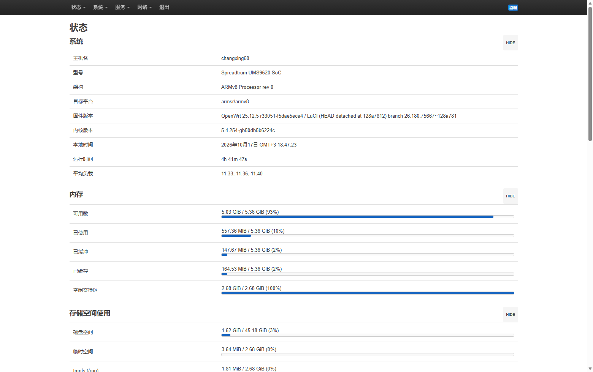
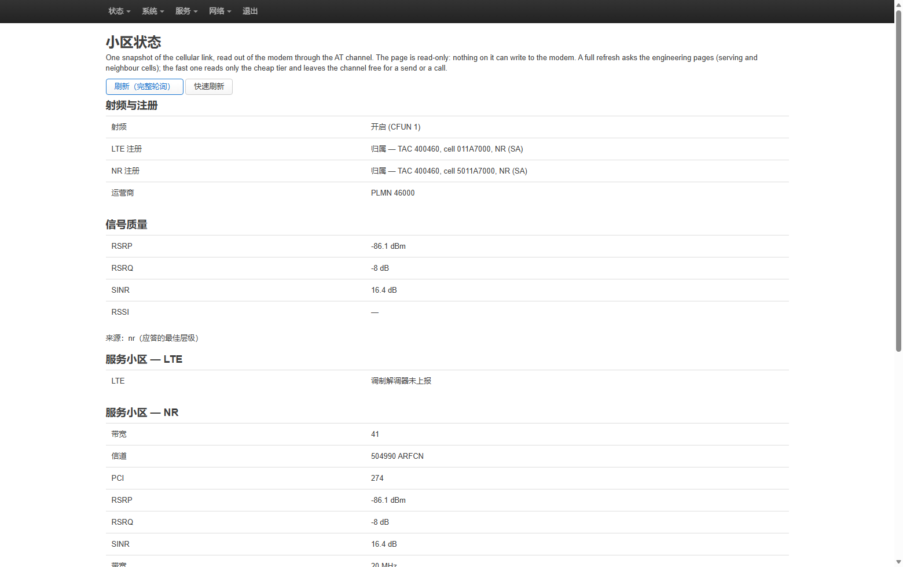
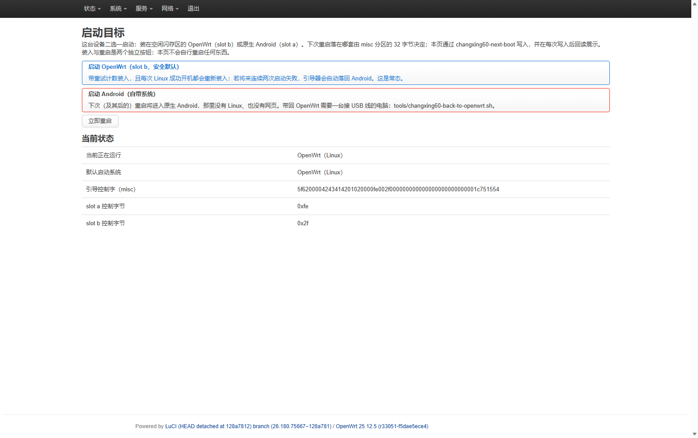

# Native OpenWrt on the ZTE 7552N "changxing60" (Unisoc T760 5G hotspot)

A complete, self-healing **OpenWrt 25.12** port for the ZTE 7552N (P720S20) 5G hotspot — board name
`changxing60`, SoC Unisoc T760 (UMS9620). It boots **next to the stock Android, in the spare A/B
slot**: no repartitioning, no `boot_a` write, no GPT change, ever. Cellular WAN (5G NSA/LTE) with
IPv6 dual-stack, a 5 GHz VHT80 hotspot with the factory BSSID pinned, a split management/tethering
LAN, a self-drawn 480×854 status page on the internal MIPI panel, an SMS stack with a web control
panel, six hand-written LuCI panels (zh-CN), and watchers that recover the modem stack when it
wedges — a reboot recovers, and a Linux boot that fails twice falls back to Android by itself.

This project targets the 7552N; it was started with the ZTE F50 / MU300 port
[dikeckaan/mu300-linux](https://github.com/dikeckaan/mu300-linux) (same SoC family) as a reference —
see References at the end. The original Ubuntu 26.04 line still builds and is selectable
(`changxing60-os ubuntu|openwrt`), but everything below is about the OpenWrt line, which is what this
repo ships and runs. The dated engineering log — measurements, failures, retracted conclusions — lives
in the companion docs repository **[6Leokk/zte7552n](https://github.com/6Leokk/zte7552n)**.

## The web admin

Services → six custom panels, each backed by an rpcd ucode service that re-reads what it wrote
("the reply is the state, not the hope"), translated to Chinese with a hand-built `.lmo` catalog:

| Overview (zh-CN) | Cellular status | Boot target (OpenWrt ↔ Android) |
|---|---|---|
|  |  |  |

The boot-target panel is the safe way to switch systems: it wraps the one script allowed to touch the
`misc` bootloader-control block, shows the 32 bytes *read back after the write*, and keeps "arm" and
"reboot" as two separate buttons. `android` is a one-way door from inside Linux — the documented way
home is `tools/changxing60-back-to-openwrt.sh` from a PC (it re-stages the driver payload, fixes 9
DTB bytes in `vendor_boot_b`, arms slot b, and verifies the USB gadget comes back).

## Status (measured, not aspirational)

| Feature | State |
|---|---|
| Custom kernel 5.4.254 (ZTE GPL source + fragment, ThinLTO) | ✅ boots slot b; vendor `wlan_combo` + `mali_kbase` + DRM built out of tree |
| OpenWrt 25.12 rootfs (`openwrt/build-rootfs.sh`, ext4 in free UFS space) | ✅ procd, ~140 MiB RAM used; 167 modules at parity with the running device |
| Cellular WAN, 5G NSA/LTE (`proto changxing60cell`) | ✅ IPv4 + IPv6 dual-stack; 4-stream 88–99 Mbps down at a client behind its NAT |
| SIPA wedge self-healing | ⚠ the vendor modem stack wedges probabilistically; watchers detect, recover, worst case reboot — [mechanism documented](https://github.com/6Leokk/zte7552n/blob/main/docs/changxing60/sipa-wedge.md) |
| 5 GHz AP (`hostapd`, ch36 VHT80) | ✅ real clients associate and surf; BSSID = factory MAC, pinned every boot from `prodnv` |
| Split LAN by design | ✅ USB gadget `br-lan` 192.168.77.1/24 = management only (no GW/DNS pushed — a Windows PC would otherwise lose its own uplink); hotspot `br-wifi` 192.168.8.1/24 |
| Six LuCI panels + zh-CN i18n | ✅ network / USB link / SMS / calls / forwarding / boot target |
| SMS receive + forward, web send | ✅ real traffic; **call audio is suspended** — vendor DSP answers pending ([evidence log](https://github.com/6Leokk/zte7552n/blob/main/docs/changxing60/telephony.md)) |
| Internal 480×854 MIPI panel | ✅ self-drawn status page, power-key backlight cycling, double-buffered; touch deliberately off |
| zram, thermal zones, charge-current pins (bq2560x) | ✅ ~215 mA average whole-board on battery (6 h 53 m measured run) |
| Bluetooth (SC2355), Mali-G57 headless OpenCL | ✅ via vendor chroot (`android-vendor/extract-*.sh`) |
| Ubuntu 26.04 line (the MU300-era line) | ✅ still builds and installs alongside (`changxing60-os`) |

## Flashing it on your own 7552N

Everything device-specific comes **out of your device**, not out of this repo: proprietary vendor
libraries, firmware blobs, the Android property regions, your serial-bearing images. What the repo
provides is the kernel build, the rootfs builder, the boot-image builder and the installer that ties
them together. You need root on the stock Android (the device has boot-verification bypass in place)
and a working SPD download-mode recovery path. Nothing writes `boot_a`, the GPT, or `userdata`.

```sh
# 1. kernel (Docker; see "Building from source" below)  -> out/{Image,modules,...}
# 2. everything else, device on rooted Android over adb:
./install.sh
```

`install.sh` checks the device, finds the free UFS region after `userdata`, pulls the vendor files it
needs into `work/` (**stays on your host; property regions are same-length neutralized on the way in** —
your serial/EMMC-id never reaches an image), builds the rootfs + boot image, asks you to confirm with
`INSTALL`, writes `boot_b`, arms slot b and reboots. First boot seeds the network (split LAN, WAN,
firewall zones) via `etc/uci-defaults`; you then configure your own hotspot SSID/PSK and your own root
password in LuCI — the shipped image is stock (empty password) on purpose.

**Prebuilt assets** (for the frozen 2026-10-17 state, matching the device this project runs): see the
[Releases page](https://github.com/6Leokk/changxing60-linux/releases) — the rootfs tarball, the slot-b
boot image, the 32-byte `misc` block, and SHA256SUMS. The tarball contains Unisoc/ZTE firmware needed
for Wi-Fi/modem operation; it is distributed here for convenience and will be pulled on a rights
holder's request. `vendor_boot_b` (the stock ZTE image patched by 9 DTB bytes) is **not** distributed —
`tools/changxing60-back-to-openwrt.sh` and `boot/` show how to produce yours.

> **Never flash generic OpenWrt arm64 images or use `sysupgrade` on this device** — they target
> generic disks and would overwrite the eMMC/UFS layout. The installed OpenWrt blocks sysupgrade.
> `apk upgrade` is fine except `kernel`/`kmod-*` (this runs its own 5.4 build).

## Switching systems

| From → to | How |
|---|---|
| OpenWrt → Android | LuCI → Services → 启动目标 (boot target), or `changxing60-next-boot android`, then reboot |
| Android → OpenWrt | `tools/changxing60-back-to-openwrt.sh` from a PC (payload → 9 DTB bytes → arm slot b → reboot → verify USB); if `boot_b` still holds the trial image it is a pure 32-byte misc write (`boot/android-boot-linux.sh`) |
| Any boot, automatic | every completed OpenWrt boot re-arms slot b (~70 s uptime); two failed boots roll back to Android by themselves |

Don't reboot twice within the first ~70 s of an OpenWrt boot — the re-arm has not run yet and the
tries counter falls back to Android. Physical fallback: long-press power (PMIC behavior on this
revision is not measured).

## Building from source

* **Kernel** — ZTE's 5.4 GPL release (mirrored at
  [dikeckaan/zte-ums9620-kernel-5.4.254](https://github.com/dikeckaan/zte-ums9620-kernel-5.4.254)):
  `kernel/build-linux.sh` merges `changxing60-linux.fragment`, ThinLTO builds `Image` + modules.
  Out-of-tree: `kernel/build-wlan.sh` (realme C51/C53 `wlan_combo` GPL source + our patches),
  `kernel/build-mali-54.sh` (mali r40p0), `kernel/build-internal-display.sh` (`sprd-drm` as a module).
  Stage with `python3 tools/stage-modules.py` — it copies the *transitive closure* of what the rootfs
  loads and fails loudly on omissions; hand-copying "all `*.ko`" is how zram/thermal/wcn drivers
  silently stayed out of the image for weeks.
* **Rootfs** — `openwrt/build-rootfs.sh [OUT.tar.gz]`: OpenWrt armsr base (checksum-verified) + this
  repo's `openwrt/overlay/` (scripts, panels, i18n) + staged modules/firmware/vendor subset. Run it
  via `install.sh`, or directly with `CHANGXING60_INPUTS=<abs path to work/>`; it guards required
  inputs and warns when `out/modules` is newer than the staged set.
* **Boot image** — `boot/build-boot-image.py` assembles the Android-format `boot_b` payload (kernel +
  `boot/init` ramdisk + module-order). Never a `boot_a` write.
* **Host tooling** — `tools/`: `check-scripts.sh` (196 static guards over every shell/ucode/js file
  the image ships — quoting traps, x-bits, LuCI module-vs-global `ReferenceError` classes),
  `luci-view-check.js` (executes each LuCI view the way luci.js compiles it), `deploy-pending.sh`
  (push changed management files to a live device with per-file md5 receipts),
  `net-scope-test.sh` / `net-down-test.sh` (throughput and DHCP scope probes),
  `i18n/` (`.lmo` catalog builder + zh-CN deploy), `stage-modules.py`.
* **Publishing** — `tools/publish-github.sh`: GitHub only ever receives a sanitized clone (see
  Credentials below), verified pattern-clean across every revision before the push.

## Repository layout

| Path | Contents |
|---|---|
| `boot/` | `init` (module loader + root mount), `module-order.txt`, `build-boot-image.py`, `flash-trial.sh`, `android-boot-linux.sh` |
| `kernel/` | build env, stock config + fragment, patches (wlan_combo, marlin3 link policy, mem-skip, regdb cert, PCM guard), build scripts |
| `openwrt/` | `build-rootfs.sh` + `overlay/` — the shipped image: init scripts, uci-defaults, LuCI views + rpcd ucode + acl/menu + zh-CN `.lmo` |
| `rootfs/` | the upstream Ubuntu 26.04 line (Dockerfile, systemd units) — still selectable |
| `android-vendor/` | extract the Android runtime subset / GPU userspace **from your device**; property regions neutralized on extraction |
| `tools/` | host-side: guards, deploy, tests, i18n build, module staging, publish |
| `docs/` | `FINDINGS.md` (engineering log, started upstream and continued here) and screenshots |
| `install.sh` | the one-command installer (checks → pull → build → write `boot_b` + arm slot b) |

## Credentials & privacy policy

No credentials of any live device are in this repository or its history: root passwords, hotspot PSKs,
IMEI/serials, Bluetooth/Wi-Fi MACs and machine codes are kept host-side (`$CHANGXING60_PASSWORD[_FILE]`
or `~/.changxing60-*`). History predating that policy is rewritten at publish time by
`tools/publish-github.sh` (filter-repo over a throwaway clone + a pattern sweep across every revision
that aborts the push on any hit). The shipped image's root account has an empty password — stock
behaviour, deliberately: set your own before connecting the device to anything.

## References

Projects this port referenced or drew from:

* [**dikeckaan/mu300-linux**](https://github.com/dikeckaan/mu300-linux) — the ZTE F50 / MU300 port
  (same SoC family). Its history is the base this repo's branch carries (the boot/slot mechanism and
  the earliest `openwrt/` rootfs line come from it). All changxing60/7552N work — panels, i18n,
  self-healing, the internal screen, SMS, the publish tooling — was developed in this project.
* [**dikeckaan/zte-ums9620-kernel-5.4.254**](https://github.com/dikeckaan/zte-ums9620-kernel-5.4.254)
  — mirror of ZTE's GPL kernel release; a build input (see *Building from source*).
* **The e5 / UMS9621 port community** (kanoqwq et al.) — sister-device reference for modem handling
  and CP recovery; comparison in the docs repo.
* **realme C51/C53 `wlan_combo` GPL source** — the vendor Wi-Fi driver built out of tree.

## License

* Scripts, tools, LuCI panels and documentation in this repository: MIT (see `LICENSE`). The upstream
  copyright notice inside `LICENSE` stays because MIT requires preserving it for the base commits.
* Kernel sources and the `wlan_combo` driver remain GPL-2.0 (ZTE/unisoc/realme releases, linked above).
* Stock firmware, vendor binaries and bootloaders belong to their owners and are not distributed
  from this repo (the release tarball's firmware note above is the only exception, by device-owner
  convenience). Nothing here is endorsed by ZTE or Unisoc; you can brick your device.
